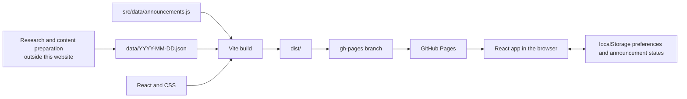

# Architecture

**English** | [简体中文](zh-CN/architecture.md)

[Documentation index](README.md)

## How the site works

This is a client-rendered static website. React handles interaction, Vite builds the frontend, and GitHub Pages serves the static files. There is no website backend, database, user account system or server-side market-data endpoint.

The Vite plugin in `scripts/brief-assets.js` reads the source JSON at build time. It embeds the sorted dates in the app and emits each full report, archive preview page and search index as a static JSON file under `dist/briefs/`. The browser requests the selected edition, defaulting to the latest.

Adding report JSON or announcements therefore requires rebuilding and deploying. Stopping the local generation device does not affect static pages already published.

## Code map

| Path                                                                    | Responsibility                                                                                 |
| ----------------------------------------------------------------------- | ---------------------------------------------------------------------------------------------- |
| [index.html](../index.html)                                             | HTML entry, SEO metadata, preference initialization and the shared analytics script            |
| [src/main.jsx](../src/main.jsx)                                         | Mount React, enable StrictMode and import global styles                                        |
| [src/App.jsx](../src/App.jsx)                                           | Main layout, bilingual UI copy, edition selection, archive, search and main reading components |
| [src/App.css](../src/App.css)                                           | Page layout, news and quote cards, reading controls and responsive rules                       |
| [src/index.css](../src/index.css)                                       | Theme variables, fonts, base styles and reading scale                                          |
| [src/lib/reports.js](../src/lib/reports.js)                             | Text fallback, localized arrays, search, dates, links and quote-change calculations            |
| [src/components/EditionPicker.jsx](../src/components/EditionPicker.jsx) | Date search, month groups and keyboard selection; CSS is in the same directory                 |
| [src/components/Announcements.jsx](../src/components/Announcements.jsx) | Announcement bell, banner, native dialog drawer and category list                              |
| [src/lib/useAnnouncements.js](../src/lib/useAnnouncements.js)           | Read and dismissed states, local persistence and cross-tab synchronization                     |
| [src/data/announcements.js](../src/data/announcements.js)               | Site notices and reader-facing release notes                                                   |
| [data/](../data/)                                                       | Briefing JSON files; see [Report data](report-data.md)                                         |
| [public/](../public/)                                                   | Icons, sharing image, robots, sitemap and other assets copied unchanged                        |
| [vite.config.js](../vite.config.js)                                     | React plugin and the `/finance/` deployment base                                               |
| `dist/`                                                                 | Generated deployment output, ignored by Git                                                    |

`MetricStrip`, `NewsList`, `ReportSidebar`, `RecentBriefs`, `Sectors` and `Premarket` are currently defined inside `App.jsx`, not separate files. The legacy root `assets/` directory is not the current Vite build output.

## Page state and URLs

- The default edition is the newest valid report. `?date=YYYY-MM-DD` opens an existing historical edition; an unknown date falls back to the latest report.
- Edition changes use `history.replaceState` to update the date parameter without adding a history entry for each selection. Selecting the latest edition removes the parameter.
- The briefing/archive view, search query, archive display count and mobile navigation state are local React state, not URL state.
- `#stories`, `#sectors` and `#premarket` navigate within the current edition. The app does not use React Router or routes such as `/finance/YYYY-MM-DD`.
- The archive fetches 18 previews on opening and another batch when readers select **Load more briefs**. Opening a card requests that edition's full report.
- Entering a search term fetches a separate archive-wide index with dates, summaries, news, sectors, premarket focus and judgments. Matching is case-insensitive and runs in the browser.
- An hourly timer reloads the page if it is hidden and browser speech is neither active nor queued. There is no foreground live-quote refresh.

## Browser storage

| localStorage key                  | Content                             | Default     |
| --------------------------------- | ----------------------------------- | ----------- |
| `lang`                            | `zh` / `en`                         | `zh`        |
| `theme`                           | `light` / `dark`                    | `light`     |
| `reading-size`                    | `small` / `medium` / `large`        | `medium`    |
| `reading-mode`                    | `compact` / `full`                  | `full`      |
| `clawbot:announcements:read`      | JSON array of read announcement IDs | Empty array |
| `clawbot:announcements:dismissed` | JSON array of dismissed banner IDs  | Empty array |

Settings belong to the current browser and origin and do not synchronize across devices. When storage is unavailable, controls still work within the current page, but a reload may restore defaults. Announcement states synchronize between same-origin tabs through `storage` events; reading preferences have no equivalent live synchronization.

Before React loads, `index.html` initializes root attributes for the theme, text size and reading view to reduce initial style flashing. React then updates those attributes and saves preferences. Check both places when changing defaults.

## Reading and styling conventions

- `BriefListening.jsx` uses the browser’s Web Speech API to read the active edition’s summary, story titles and explanations, and the premarket risk note. It prefers an installed voice that matches the interface language. Pause resumes from the start of the current segment. Opening the archive or changing the edition or language ends playback. Audio is produced at playback time with the available device voices.

- Semantic variables in `src/index.css`, such as `--bg`, `--heading`, `--line` and `--green-soft`, define the light and dark themes. Reuse them for new styles.
- `--reading-scale` is 0.9, 1 or 1.2 for small, medium or large text. It mainly affects report copy and headlines, not the entire page.
- Brief view uses native `
` elements for story details, sector radar and premarket focus. Changing the report or reading view rebuilds these disclosure states through component keys.
- The edition picker handles keyboard navigation separately. Announcements use a native dialog with `showModal()` and restore the previous focus on close. Preserve semantics and visible focus when editing these controls.
- Main responsive breakpoints include 1250, 1030, 760 and 480 pixels; announcements also have 360-pixel rules. At widths of 1030 pixels or less, recent briefs move below the report body.

## External dependencies and boundaries

| Dependency                        | Current use and boundary                                                                             |
| --------------------------------- | ---------------------------------------------------------------------------------------------------- |
| GitHub Pages                      | Hosts built files; hosting configuration lives in GitHub and is not fully defined by this repository |
| Google Fonts                      | Loads the serif font; CSS provides system font fallbacks                                             |
| News source links                 | Open the original article; missing valid HTTP(S) links fall back to a Google search for the headline |
| Quote source URLs                 | Stored in report data for traceability; the frontend displays recorded prices                        |
| Shared main-site analytics script | `index.html` loads `https://yutaozhou.com/js/site-analytics.js?v=2` with project `finance`           |

The main site maintains the analytics implementation. This repository provides `data-report-date`, `data-analytics-language`, `data-analytics-view` and a reading-end marker. It does not contain the analytics backend or full event implementation, so it cannot establish what the server actually stores.

There is no complete report-generation pipeline, automated test suite or print/save-as-PDF feature.
