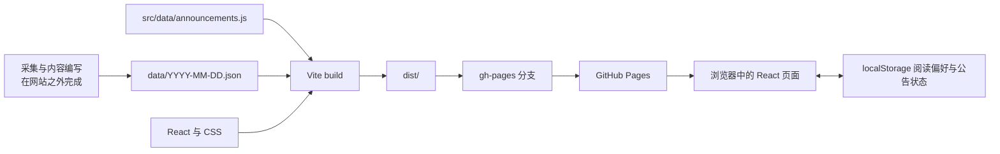

# 架构说明

[English](../architecture.md) | **简体中文**

[返回文档导航](README.md)

## 网站如何工作

这是一个客户端渲染的静态网站。React 负责交互，Vite 构建前端，GitHub Pages 提供静态托管。当前没有网站后端、数据库、用户账号或服务端行情接口。

`App.jsx` 通过 `import.meta.glob("../data/*.json", { eager: true })` 在构建时导入晨报，按 `date` 格式过滤，再按日期倒序排列。网站打开后不会从行情供应商实时抓取报价，也不会轮询 `data/` 目录。

因此，新增 JSON 或公告后需要重新构建和部署；本地生成设备停止运行，不会影响已经发布的静态页面。

## 代码地图

| 路径                                                                       | 职责                                                     |
| -------------------------------------------------------------------------- | -------------------------------------------------------- |
| [index.html](../../index.html)                                             | HTML 入口、SEO 元数据、偏好预加载、共享统计脚本          |
| [src/main.jsx](../../src/main.jsx)                                         | 挂载 React，启用 StrictMode，引入全局样式                |
| [src/App.jsx](../../src/App.jsx)                                           | 主布局、双语 UI 文案、晨报选择、归档、搜索和主要阅读组件 |
| [src/App.css](../../src/App.css)                                           | 页面布局、新闻与行情卡片、阅读控件、响应式规则           |
| [src/index.css](../../src/index.css)                                       | 主题变量、字体、基础样式和阅读缩放变量                   |
| [src/lib/reports.js](../../src/lib/reports.js)                             | 文本回退、数组本地化、搜索、日期、链接和行情差值计算     |
| [src/components/EditionPicker.jsx](../../src/components/EditionPicker.jsx) | 日期搜索、月份分组和键盘选择，样式在同目录 CSS           |
| [src/components/Announcements.jsx](../../src/components/Announcements.jsx) | 公告铃铛、横幅、原生 dialog 抽屉和分类列表               |
| [src/lib/useAnnouncements.js](../../src/lib/useAnnouncements.js)           | 公告已读、横幅关闭、本地持久化和跨标签页同步             |
| [src/data/announcements.js](../../src/data/announcements.js)               | 网站公告与读者可见的功能更新记录                         |
| [data/](../../data/)                                                       | 各期晨报 JSON，格式见[数据参考](report-data.md)          |
| [public/](../../public/)                                                   | 图标、分享图、robots、sitemap 等原样复制的静态资源       |
| [vite.config.js](../../vite.config.js)                                     | React 插件及 `/finance/` 部署路径                        |
| `dist/`                                                                    | 生成的发布产物，已被 Git 忽略                            |

`MetricStrip`、`NewsList`、`ReportSidebar`、`RecentBriefs`、`Sectors` 和 `Premarket` 当前都定义在 `App.jsx`，不是独立文件。根目录旧的 `assets/` 不是当前 Vite 的构建输出目录。

## 页面状态与 URL

- 默认选中日期最新的一份有效晨报；`?date=YYYY-MM-DD` 可以直接打开已有历史晨报，不存在的日期会回退到最新一期。
- 切换晨报使用 `history.replaceState` 更新日期参数，不会为每次切换增加浏览器历史记录。选择最新一期时移除 `date` 参数。
- 今日晨报、归档视图、搜索词、归档加载数量和手机导航的开关由 React 本地状态控制，不写入 URL。
- `#stories`、`#sectors`、`#premarket` 用于本期页面内导航；项目未使用 React Router 或 `/finance/YYYY-MM-DD` 这类路径路由。
- 归档初始展示 18 期，每次加载再增加 18 期。这里分页的是界面展示，数据已随初始 JavaScript 一次加载。
- 全站搜索匹配日期、摘要、新闻、板块、盘前关注和观点的序列化文本，忽略大小写。它不是外部搜索引擎，也不搜索公告。
- 页面每小时检查一次可见性，只有在处于后台且没有正在播放或排队的浏览器语音时才刷新。前台没有实时行情刷新。

## 浏览器存储

| localStorage 键                   | 内容                         | 默认值   |
| --------------------------------- | ---------------------------- | -------- |
| `lang`                            | `zh` / `en`                  | `zh`     |
| `theme`                           | `light` / `dark`             | `light`  |
| `reading-size`                    | `small` / `medium` / `large` | `medium` |
| `reading-mode`                    | `compact` / `full`           | `full`   |
| `clawbot:announcements:read`      | 已读公告 ID 的 JSON 数组     | 空数组   |
| `clawbot:announcements:dismissed` | 已关闭横幅的公告 ID 数组     | 空数组   |

这些设置只属于当前浏览器和站点来源，不跨设备同步。禁用存储时，控件仍可在当前页面中工作，但刷新后可能恢复默认。公告状态通过 `storage` 事件在同源标签页同步；阅读偏好没有对应的实时同步逻辑。

`index.html` 在 React 加载前设置主题、字号和阅读模式的根元素属性，减少初始样式闪动。React 随后更新这些属性并保存偏好。修改默认值时需要同时核对这两个位置。

## 阅读与样式约定

- `BriefListening.jsx` 使用浏览器的 Web Speech API 朗读本期摘要、新闻标题及解读和盘前风险提示，优先使用设备上与界面语言匹配的音色。暂停后从当前段开头继续。进入归档或切换日期、语言会结束播放。声音由设备提供的音色在播放时合成。

- `src/index.css` 中的语义变量（如 `--bg`、`--heading`、`--line`、`--green-soft`）定义深浅主题。新增样式优先复用变量。
- `--reading-scale` 对小／中／大分别为 0.9、1、1.2，主要影响正文与新闻标题，不是整页缩放。
- 精简模式使用原生 `
` 展开新闻详情、板块雷达和盘前关注。更换晨报或阅读模式时通过组件 key 重建相应展开状态。
- 日期选择器有独立键盘处理；公告使用原生 `<dialog>.showModal()`，关闭时恢复此前焦点。修改时需要保留语义标签和可见焦点。
- 主要响应式断点包括 1250、1030、760 和 480 像素，公告还有 360 像素规则。最近晨报在不超过 1030 像素时移到正文之后。

## 外部依赖与当前边界

| 依赖             | 当前用途与边界                                                                           |
| ---------------- | ---------------------------------------------------------------------------------------- |
| GitHub Pages     | 托管已构建文件；托管设置位于 GitHub，不由本仓库完全定义                                  |
| Google Fonts     | 加载衬线字体；CSS 同时提供系统字体回退                                                   |
| 新闻来源链接     | 从浏览器跳转原文；缺少有效 HTTP(S) 链接时提供 Google 新闻标题搜索                        |
| 行情来源 URL     | 保存在晨报数据中供溯源；前端展示的是已记录价格                                           |
| 主站共享统计脚本 | `index.html` 加载 `https://yutaozhou.com/js/site-analytics.js?v=2`，标记项目为 `finance` |

统计脚本实现由主站维护。本仓库提供 `data-report-date`、`data-analytics-language`、`data-analytics-view` 和阅读结束标记，不包含统计后台或完整事件实现，不能仅凭本仓库判断服务端实际保存的内容。

当前没有完整的晨报生成管线、自动化测试套件或打印／保存 PDF 功能。全部历史 JSON 使用 eager 导入，构建会产生较大的 JavaScript 包；按日期拆分加载是后续架构改进方向，尚未实现。
